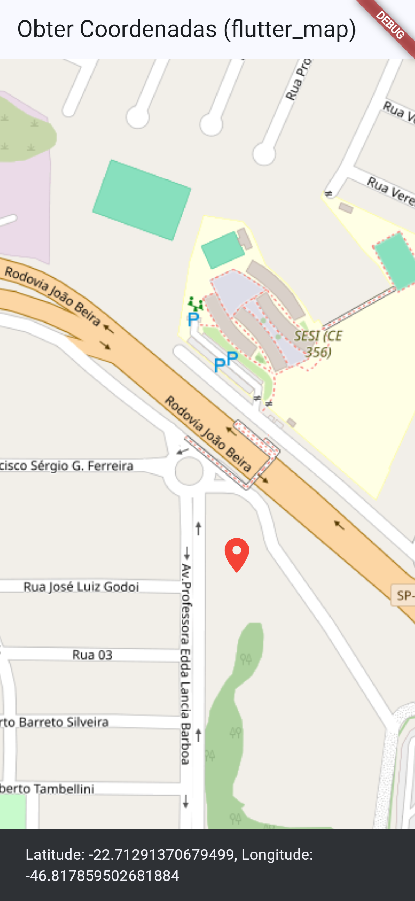

# flutter_maps_nativo

🗺️ Flutter Maps

Aplicativo desenvolvido em Flutter com integração de mapas.

📱 Print

🛠️ Tecnologias

Flutter

Dart

Flutter Maps

VsCode

🚀 Funcionalidades

Visualização do mapa

Longitude e Latitude

Marcadores de localização

📄 Projeto

Projeto desenvolvido para fins de estudo.